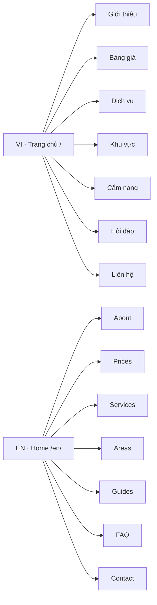

# BẢN ĐỒ MENU – DANH MỤC – TRANG VI/EN (NGUYỄN HÀ)

> **ĐỌC TRƯỚC KHI VIẾT BẤT KỲ BÀI NÀO.** Áp dụng cho ChatGPT, Claude, GitHub Copilot và các Writer làm việc trong `thuexemayhanoi/wp-aiwriter`. Đây là bản đồ **cấu trúc site**, không phải lệnh để tự sửa menu hoặc URL.  
> Nguồn: GET WordPress REST xác thực ngày **20/10/2026**; dữ liệu gốc máy đọc ở [`data/navigation-map.json`](../data/navigation-map.json). Nếu dữ liệu live thay đổi, **WordPress là nguồn chuẩn; dừng đăng mục chưa rõ và cập nhật bản đồ bằng PR riêng.**

## 0. Nhìn nhanh trước khi làm

- **Website duy nhất:** https://blog.rentbikehanoi.com/ — thương hiệu **Nguyễn Hà**. **Không nhầm với** `thuexemaynguyentu.com` hay repo `/wp-writer`, `/global`.
- **4 menu đang sử dụng:** VI header **26** (WordPress location `primary`), VI footer **29** (`footer`), EN header **57** (`primary-en` qua hệ song ngữ), EN footer **58** (`footer-en`). Các menu 24, 25, 27, 28 là cấu hình khác/cũ, **không dùng làm chuẩn viết bài**.
- **8 mục chính mỗi ngôn ngữ:** VI **8** · EN **8**. Tổng item tính menu con: VI **16**, EN **28**. Footer VI **8**, footer EN **11**.
- **Danh mục bài viết:** VI **22 Term** (gồm **Uncategorized #1**, không phải silo xuất bản); EN **21 Term** (gồm cả cha/con). Tổng **43** Term đang tồn tại. **Danh mục cha không nhất thiết có con trong menu.**
- **Trang tĩnh:** VI **18 Page**, EN **19 Page**, các trang EN mới là nội dung tiếng Anh viết riêng.
- **22 bài EN đã VERIFIED** tại thời điểm hoàn tất seed; **500** là *kế hoạch bài*, không phải 500 bài đã đăng. Xem `data/en-publication-state.json` để biết thực tế.
- **Đừng nhầm các ID:** Menu Item ID là một dòng menu; **Term ID** là danh mục bài; **Page ID** là trang độc lập. `parent_menu_item_id`, `parent_term_id` và `parent_page_id` **không thể hoán đổi**.

## 1. Cấu trúc menu trực quan

**Lưu ý:** Sơ đồ phía trên tóm tắt 8 mục ngoài cùng (tính cả Trang chủ/Home). Các phần **2–4** bên dưới là toàn bộ cây menu và **cây danh mục đầy đủ**, không rút gọn. Không lấy một mục menu để giả định đó là một danh mục WordPress.

## 2. Menu chính VI — menu ID 26 (cây cha/con thực tế)

- [Trang chủ](https://blog.rentbikehanoi.com/) (menu item 1228; Page ID 1228)
- [Giới thiệu](https://blog.rentbikehanoi.com/gioi-thieu/) (menu item 75; Page ID 14)
- [Bảng giá](https://blog.rentbikehanoi.com/bang-gia/) (menu item 84; Page ID 19)
- [Dịch vụ](https://blog.rentbikehanoi.com/dich-vu/) (menu item 76; Page ID 15)
  - [Xe máy](https://blog.rentbikehanoi.com/thue-xe-may-ha-noi/) (menu item 81; Page ID 16)
  - [Xe 50cc](https://blog.rentbikehanoi.com/xe-50cc/) (menu item 82; Page ID 17)
  - [Xe điện](https://blog.rentbikehanoi.com/xe-dien/) (menu item 83; Page ID 18)
- [Khu vực](https://blog.rentbikehanoi.com/khu-vuc/) (menu item 77; Page ID 20)
  - [Hoàn Kiếm](https://blog.rentbikehanoi.com/hoan-kiem/) (menu item 85; Page ID 21)
    - [Phố Cổ](https://blog.rentbikehanoi.com/pho-co/) (menu item 92; Page ID 22)
  - [Long Biên](https://blog.rentbikehanoi.com/long-bien/) (menu item 86; Page ID 26)
  - [Ba Đình](https://blog.rentbikehanoi.com/ba-dinh/) (menu item 87; Page ID 27)
  - [Gia Lâm](https://blog.rentbikehanoi.com/gia-lam/) (menu item 90; Page ID 28)
- [Cẩm nang](https://blog.rentbikehanoi.com/cam-nang/) (menu item 78; Page ID 23)
- [Hỏi đáp](https://blog.rentbikehanoi.com/hoi-dap/) (menu item 79; Page ID 24)
- [Liên hệ](https://blog.rentbikehanoi.com/lien-he/) (menu item 80; Page ID 25)

**Điểm đặc biệt:** `Trang chủ` ở menu chính VI là custom link **`/`**, không đồng nhất với URL lưu của Page ID 13 `/thue-xe-may-ha-noi-nguyen-ha/`. **Giữ cả hai URL hiện có; không đổi hoặc redirect theo suy đoán.**

## 3. Menu chính EN — menu ID 57 (cây cha/con thực tế)

- [Home](https://blog.rentbikehanoi.com/en/) (menu item 1767; Page ID 1758)
- [About](https://blog.rentbikehanoi.com/en/about/) (menu item 1771; Page ID 1759)
- [Prices](https://blog.rentbikehanoi.com/en/prices/) (menu item 1769; Page ID 1760)
- [Services](https://blog.rentbikehanoi.com/en/services/) (menu item 1839; Page ID 1827)
  - [Motorbikes](https://blog.rentbikehanoi.com/en/motorbikes/) (menu item 1768; Page ID 1764)
    - [Manual Motorbikes](https://blog.rentbikehanoi.com/en/category/hanoi-motorbike-rental/manual-motorbikes/) (menu item 1773; Term ID 49)
    - [Automatic Scooters](https://blog.rentbikehanoi.com/en/category/hanoi-motorbike-rental/automatic-scooters/) (menu item 1774; Term ID 50)
  - [50cc Bikes](https://blog.rentbikehanoi.com/en/50cc-bikes/) (menu item 1847; Page ID 1828)
    - [50cc Motorbikes](https://blog.rentbikehanoi.com/en/category/hanoi-motorbike-rental/50cc-motorbikes/) (menu item 1775; Term ID 51)
  - [Electric Bikes](https://blog.rentbikehanoi.com/en/electric-scooters/) (menu item 1848; Page ID 1829)
    - [Electric Bikes & Scooters](https://blog.rentbikehanoi.com/en/category/hanoi-motorbike-rental/electric-bikes-scooters/) (menu item 1776; Term ID 52)
  - [Rental Guide](https://blog.rentbikehanoi.com/en/rental-guide/) (menu item 1770; Page ID 1762)
- [Areas](https://blog.rentbikehanoi.com/en/areas/) (menu item 1840; Page ID 1831)
  - [Hoan Kiem](https://blog.rentbikehanoi.com/en/hoan-kiem/) (menu item 1843; Page ID 1832)
    - [Old Quarter](https://blog.rentbikehanoi.com/en/old-quarter/) (menu item 1850; Page ID 1833)
  - [Long Bien](https://blog.rentbikehanoi.com/en/long-bien/) (menu item 1844; Page ID 1834)
  - [Ba Dinh](https://blog.rentbikehanoi.com/en/ba-dinh/) (menu item 1845; Page ID 1835)
  - [Gia Lam](https://blog.rentbikehanoi.com/en/gia-lam/) (menu item 1846; Page ID 1836)
- [Guides](https://blog.rentbikehanoi.com/en/guides/) (menu item 1841; Page ID 1830)
  - [Motorbike Rental Guides](https://blog.rentbikehanoi.com/en/category/hanoi-motorbike-rental/) (menu item 1849; Term ID 46)
  - [Hanoi Travel & Routes](https://blog.rentbikehanoi.com/en/category/hanoi-travel-routes/) (menu item 1777; Term ID 47)
    - [Hanoi Neighbourhoods](https://blog.rentbikehanoi.com/en/category/hanoi-travel-routes/hanoi-neighbourhoods/) (menu item 1779; Term ID 53)
    - [Suggested Motorbike Routes](https://blog.rentbikehanoi.com/en/category/hanoi-travel-routes/hanoi-motorbike-routes/) (menu item 1780; Term ID 54)
  - [Riding Advice & Safety](https://blog.rentbikehanoi.com/en/category/riding-advice-safety/) (menu item 1778; Term ID 48)
    - [Rental Tips & Paperwork](https://blog.rentbikehanoi.com/en/category/riding-advice-safety/rental-tips-paperwork/) (menu item 1781; Term ID 55)
    - [Road Rules & Rider Safety](https://blog.rentbikehanoi.com/en/category/riding-advice-safety/road-rules-rider-safety/) (menu item 1782; Term ID 56)
- [FAQ](https://blog.rentbikehanoi.com/en/faq/) (menu item 1842; Page ID 1763)
- [Contact](https://blog.rentbikehanoi.com/en/contact/) (menu item 1772; Page ID 1761)

**Phân biệt:** EN menu chứa cả **page** (ví dụ `/en/services/`) và **category archive** (ví dụ `/en/category/hanoi-motorbike-rental/`). Menu item archive có thể được REST trả về dưới `/category/...` không có `/en/`; plugin song ngữ hiển thị tuyến công khai dạng **`/en/category/...`**. **Không sửa slug/canonical chỉ vì hai dạng URL hiển thị khác nhau.** Nếu URL công khai lỗi hãy xác minh trên web trước khi chỉnh.

## 4. Hai menu footer hiện tại

### Footer VI — menu ID 29

- [Giới thiệu](https://blog.rentbikehanoi.com/gioi-thieu/) (menu item 126; Page ID 14)
- [Dịch vụ](https://blog.rentbikehanoi.com/dich-vu/) (menu item 127; Page ID 15)
- [Khu vực](https://blog.rentbikehanoi.com/khu-vuc/) (menu item 128; Page ID 20)
- [Cẩm nang](https://blog.rentbikehanoi.com/cam-nang/) (menu item 129; Page ID 23)
- [Hỏi đáp](https://blog.rentbikehanoi.com/hoi-dap/) (menu item 130; Page ID 24)
- [Liên hệ](https://blog.rentbikehanoi.com/lien-he/) (menu item 131; Page ID 25)
- [Bảo mật](https://blog.rentbikehanoi.com/bao-mat/) (menu item 132; Page ID 3)
- [Điều khoản](https://blog.rentbikehanoi.com/dieu-khoan/) (menu item 133; Page ID 29)

### Footer EN — menu ID 58

- [Home](https://blog.rentbikehanoi.com/en/) (menu item 1783; Page ID 1758)
- [Prices](https://blog.rentbikehanoi.com/en/prices/) (menu item 1784; Page ID 1760)
- [FAQ](https://blog.rentbikehanoi.com/en/faq/) (menu item 1785; Page ID 1763)
- [About](https://blog.rentbikehanoi.com/en/about/) (menu item 1786; Page ID 1759)
- [Contact](https://blog.rentbikehanoi.com/en/contact/) (menu item 1787; Page ID 1761)
- [Services](https://blog.rentbikehanoi.com/en/services/) (menu item 1851; Page ID 1827)
- [Areas](https://blog.rentbikehanoi.com/en/areas/) (menu item 1852; Page ID 1831)
- [Guides](https://blog.rentbikehanoi.com/en/guides/) (menu item 1853; Page ID 1830)
- [Rental Guide](https://blog.rentbikehanoi.com/en/rental-guide/) (menu item 1854; Page ID 1762)
- [Privacy](https://blog.rentbikehanoi.com/en/privacy/) (menu item 1855; Page ID 1837)
- [Terms](https://blog.rentbikehanoi.com/en/terms/) (menu item 1856; Page ID 1838)

**Footer khác header:** có Bảo mật / Privacy, Điều khoản / Terms và các đường dẫn dài hạn; không cần bê mọi danh mục sâu lên thanh header.

## 5. Toàn bộ danh mục VI — **Term ID 1, 3–23**, giữ nguyên hierarchy

- [Uncategorized](https://blog.rentbikehanoi.com/category/uncategorized/) — **Term ID 1**; parent `0`; bài gán trực tiếp khi chụp: 1
- [Dịch vụ](https://blog.rentbikehanoi.com/category/dich-vu/) — **Term ID 3**; parent `0`; bài gán trực tiếp khi chụp: 0
  - [Xe máy](https://blog.rentbikehanoi.com/category/dich-vu/xe-may/) — **Term ID 4**; parent `3`; bài gán trực tiếp khi chụp: 1
    - [Xe 50cc](https://blog.rentbikehanoi.com/category/dich-vu/xe-may/xe-50cc/) — **Term ID 5**; parent `4`; bài gán trực tiếp khi chụp: 25
    - [Xe số](https://blog.rentbikehanoi.com/category/dich-vu/xe-may/xe-so/) — **Term ID 6**; parent `4`; bài gán trực tiếp khi chụp: 45
    - [Xe ga](https://blog.rentbikehanoi.com/category/dich-vu/xe-may/xe-ga/) — **Term ID 7**; parent `4`; bài gán trực tiếp khi chụp: 55
  - [Xe điện](https://blog.rentbikehanoi.com/category/dich-vu/xe-dien/) — **Term ID 8**; parent `3`; bài gán trực tiếp khi chụp: 35
- [Khu vực](https://blog.rentbikehanoi.com/category/khu-vuc/) — **Term ID 9**; parent `0`; bài gán trực tiếp khi chụp: 0
  - [Hoàn Kiếm](https://blog.rentbikehanoi.com/category/khu-vuc/hoan-kiem/) — **Term ID 10**; parent `9`; bài gán trực tiếp khi chụp: 15
    - [Phố Cổ](https://blog.rentbikehanoi.com/category/khu-vuc/hoan-kiem/pho-co/) — **Term ID 11**; parent `10`; bài gán trực tiếp khi chụp: 8
  - [Long Biên](https://blog.rentbikehanoi.com/category/khu-vuc/long-bien/) — **Term ID 12**; parent `9`; bài gán trực tiếp khi chụp: 16
  - [Ba Đình](https://blog.rentbikehanoi.com/category/khu-vuc/ba-dinh/) — **Term ID 13**; parent `9`; bài gán trực tiếp khi chụp: 10
  - [Gia Lâm](https://blog.rentbikehanoi.com/category/khu-vuc/gia-lam/) — **Term ID 14**; parent `9`; bài gán trực tiếp khi chụp: 13
- [Cẩm nang](https://blog.rentbikehanoi.com/category/cam-nang/) — **Term ID 15**; parent `0`; bài gán trực tiếp khi chụp: 4
  - [Ứng dụng](https://blog.rentbikehanoi.com/category/cam-nang/ung-dung/) — **Term ID 16**; parent `15`; bài gán trực tiếp khi chụp: 0
    - [App xe máy](https://blog.rentbikehanoi.com/category/cam-nang/ung-dung/app-xe-may/) — **Term ID 17**; parent `16`; bài gán trực tiếp khi chụp: 25
    - [App xe điện](https://blog.rentbikehanoi.com/category/cam-nang/ung-dung/app-xe-dien/) — **Term ID 18**; parent `16`; bài gán trực tiếp khi chụp: 20
  - [Hãng xe](https://blog.rentbikehanoi.com/category/cam-nang/hang-xe/) — **Term ID 19**; parent `15`; bài gán trực tiếp khi chụp: 6
    - [Hãng xe máy](https://blog.rentbikehanoi.com/category/cam-nang/hang-xe/hang-xe-may/) — **Term ID 20**; parent `19`; bài gán trực tiếp khi chụp: 55
    - [Hãng xe điện](https://blog.rentbikehanoi.com/category/cam-nang/hang-xe/hang-xe-dien/) — **Term ID 21**; parent `19`; bài gán trực tiếp khi chụp: 35
  - [Kinh nghiệm](https://blog.rentbikehanoi.com/category/cam-nang/kinh-nghiem/) — **Term ID 22**; parent `15`; bài gán trực tiếp khi chụp: 112
  - [Giao thông](https://blog.rentbikehanoi.com/category/cam-nang/giao-thong/) — **Term ID 23**; parent `15`; bài gán trực tiếp khi chụp: 35

- `Uncategorized` (ID 1) tồn tại trong WordPress nhưng **không phải đích** cho bài mới trong Excel Matrix.
- `data/topics.json` có **355 dòng** (ID 146–500) của kế hoạch VI, chứa đường dẫn `category_path` (ví dụ `Dịch vụ > Xe máy > Xe số`). **Không tự sửa file nguồn Excel**. Chọn đúng *cả cấp cha lẫn cấp con* rồi đối chiếu Term ID trên bản đồ.
- Danh mục VI có thể tồn tại trong taxonomy dù không xuất hiện trong header/footer. Điều đó bình thường: **sitemap, menu và taxonomy là ba hệ khác nhau**.

## 6. Toàn bộ danh mục EN — **21 Term ID (46–56, 60–69)**

- [Motorbike Rental in Hanoi](https://blog.rentbikehanoi.com/en/category/hanoi-motorbike-rental/) — **Term ID 46**; parent `0`; bài gán trực tiếp khi chụp: 1
  - [Manual Motorbikes](https://blog.rentbikehanoi.com/en/category/hanoi-motorbike-rental/manual-motorbikes/) — **Term ID 49**; parent `46`; bài gán trực tiếp khi chụp: 1
  - [Automatic Scooters](https://blog.rentbikehanoi.com/en/category/hanoi-motorbike-rental/automatic-scooters/) — **Term ID 50**; parent `46`; bài gán trực tiếp khi chụp: 1
  - [50cc Motorbikes](https://blog.rentbikehanoi.com/en/category/hanoi-motorbike-rental/50cc-motorbikes/) — **Term ID 51**; parent `46`; bài gán trực tiếp khi chụp: 1
  - [Electric Bikes & Scooters](https://blog.rentbikehanoi.com/en/category/hanoi-motorbike-rental/electric-bikes-scooters/) — **Term ID 52**; parent `46`; bài gán trực tiếp khi chụp: 1
  - [Honda & Yamaha Comparisons](https://blog.rentbikehanoi.com/en/category/hanoi-motorbike-rental/honda-yamaha-comparisons/) — **Term ID 65**; parent `46`; bài gán trực tiếp khi chụp: 1
  - [Motorbike Handover & Maintenance](https://blog.rentbikehanoi.com/en/category/hanoi-motorbike-rental/motorbike-handover-maintenance/) — **Term ID 66**; parent `46`; bài gán trực tiếp khi chụp: 1
  - [Weekly & Monthly Rentals](https://blog.rentbikehanoi.com/en/category/hanoi-motorbike-rental/weekly-monthly-rentals/) — **Term ID 69**; parent `46`; bài gán trực tiếp khi chụp: 1
- [Hanoi Travel & Routes](https://blog.rentbikehanoi.com/en/category/hanoi-travel-routes/) — **Term ID 47**; parent `0`; bài gán trực tiếp khi chụp: 1
  - [Hanoi Neighbourhoods](https://blog.rentbikehanoi.com/en/category/hanoi-travel-routes/hanoi-neighbourhoods/) — **Term ID 53**; parent `47`; bài gán trực tiếp khi chụp: 1
    - [Hoan Kiem Area](https://blog.rentbikehanoi.com/en/category/hanoi-travel-routes/hanoi-neighbourhoods/hoan-kiem-area/) — **Term ID 60**; parent `53`; bài gán trực tiếp khi chụp: 1
      - [Old Quarter Riding](https://blog.rentbikehanoi.com/en/category/hanoi-travel-routes/hanoi-neighbourhoods/hoan-kiem-area/old-quarter-riding/) — **Term ID 61**; parent `60`; bài gán trực tiếp khi chụp: 1
    - [Long Bien Area](https://blog.rentbikehanoi.com/en/category/hanoi-travel-routes/hanoi-neighbourhoods/long-bien-area/) — **Term ID 62**; parent `53`; bài gán trực tiếp khi chụp: 1
    - [Ba Dinh Area](https://blog.rentbikehanoi.com/en/category/hanoi-travel-routes/hanoi-neighbourhoods/ba-dinh-area/) — **Term ID 63**; parent `53`; bài gán trực tiếp khi chụp: 1
    - [Gia Lam Area](https://blog.rentbikehanoi.com/en/category/hanoi-travel-routes/hanoi-neighbourhoods/gia-lam-area/) — **Term ID 64**; parent `53`; bài gán trực tiếp khi chụp: 1
  - [Suggested Motorbike Routes](https://blog.rentbikehanoi.com/en/category/hanoi-travel-routes/hanoi-motorbike-routes/) — **Term ID 54**; parent `47`; bài gán trực tiếp khi chụp: 1
  - [Navigation Apps & Maps](https://blog.rentbikehanoi.com/en/category/hanoi-travel-routes/navigation-apps-maps/) — **Term ID 67**; parent `47`; bài gán trực tiếp khi chụp: 1
- [Riding Advice & Safety](https://blog.rentbikehanoi.com/en/category/riding-advice-safety/) — **Term ID 48**; parent `0`; bài gán trực tiếp khi chụp: 1
  - [Rental Tips & Paperwork](https://blog.rentbikehanoi.com/en/category/riding-advice-safety/rental-tips-paperwork/) — **Term ID 55**; parent `48`; bài gán trực tiếp khi chụp: 2
  - [Road Rules & Rider Safety](https://blog.rentbikehanoi.com/en/category/riding-advice-safety/road-rules-rider-safety/) — **Term ID 56**; parent `48`; bài gán trực tiếp khi chụp: 1
  - [Hanoi Traffic & Parking](https://blog.rentbikehanoi.com/en/category/riding-advice-safety/hanoi-traffic-parking/) — **Term ID 68**; parent `48`; bài gán trực tiếp khi chụp: 1

- Các category EN mới từ #60 đến #69 nằm ở nhiều cấp, **không phải 10 mục menu mới**. Các parent-hub có bài trực tiếp: **#46 Motorbike Rental**, **#47 Hanoi Travel & Routes**, **#48 Riding Advice & Safety**.
- Gốc `Hanoi Neighbourhoods #53` chứa **Hoan Kiem #60 → Old Quarter #61**, và Long Bien #62, Ba Dinh #63, Gia Lam #64. **`#53` là Term ID**, **`/en/areas/` là Page ID 1831**; KHÔNG gộp hoặc tạo lại.
- Chỉ sử dụng `category_id` đã có trong `en/topics.json` và danh sách cho phép ở `en/publication-policy.json`. **Không tự tạo danh mục cho mỗi địa phương hoặc thêm phân nhánh chỉ để đạt số lượng.**

## 7. Toàn bộ trang VI/EN — Page ID, URL độc lập

### Trang VI — 18 trang

| Page ID | Trang / Page | URL | WordPress parent page |
|---:|---|---|---:|
| 3 | Bảo mật | [`/bao-mat/`](https://blog.rentbikehanoi.com/bao-mat/) | 0 |
| 13 | Thuê xe máy Nguyễn Hà | [`/thue-xe-may-ha-noi-nguyen-ha/`](https://blog.rentbikehanoi.com/thue-xe-may-ha-noi-nguyen-ha/) | 0 |
| 14 | Giới thiệu | [`/gioi-thieu/`](https://blog.rentbikehanoi.com/gioi-thieu/) | 0 |
| 15 | Dịch vụ | [`/dich-vu/`](https://blog.rentbikehanoi.com/dich-vu/) | 0 |
| 16 | Thuê xe số và xe ga Hà Nội | [`/thue-xe-may-ha-noi/`](https://blog.rentbikehanoi.com/thue-xe-may-ha-noi/) | 0 |
| 17 | Thuê xe máy 50cc Hà Nội | [`/xe-50cc/`](https://blog.rentbikehanoi.com/xe-50cc/) | 0 |
| 18 | Thuê xe điện Hà Nội | [`/xe-dien/`](https://blog.rentbikehanoi.com/xe-dien/) | 0 |
| 19 | Bảng giá | [`/bang-gia/`](https://blog.rentbikehanoi.com/bang-gia/) | 0 |
| 20 | Khu vực | [`/khu-vuc/`](https://blog.rentbikehanoi.com/khu-vuc/) | 0 |
| 21 | Thuê xe máy Hoàn Kiếm | [`/hoan-kiem/`](https://blog.rentbikehanoi.com/hoan-kiem/) | 0 |
| 22 | Thuê xe máy Phố Cổ | [`/pho-co/`](https://blog.rentbikehanoi.com/pho-co/) | 0 |
| 23 | Cẩm nang | [`/cam-nang/`](https://blog.rentbikehanoi.com/cam-nang/) | 0 |
| 24 | Hỏi đáp | [`/hoi-dap/`](https://blog.rentbikehanoi.com/hoi-dap/) | 0 |
| 25 | Liên hệ | [`/lien-he/`](https://blog.rentbikehanoi.com/lien-he/) | 0 |
| 26 | Thuê xe máy Long Biên | [`/long-bien/`](https://blog.rentbikehanoi.com/long-bien/) | 0 |
| 27 | Thuê xe máy Ba Đình | [`/ba-dinh/`](https://blog.rentbikehanoi.com/ba-dinh/) | 0 |
| 28 | Thuê xe máy Gia Lâm | [`/gia-lam/`](https://blog.rentbikehanoi.com/gia-lam/) | 0 |
| 29 | Điều khoản | [`/dieu-khoan/`](https://blog.rentbikehanoi.com/dieu-khoan/) | 0 |

### Trang EN — 19 trang

| Page ID | Trang / Page | URL | WordPress parent page |
|---:|---|---|---:|
| 1758 | Motorbike Rental in Hanoi | [`/en/`](https://blog.rentbikehanoi.com/en/) | 0 |
| 1759 | About Nguyen Ha Motorbike Rental | [`/en/about/`](https://blog.rentbikehanoi.com/en/about/) | 1758 |
| 1760 | Motorbike Rental Prices in Hanoi | [`/en/prices/`](https://blog.rentbikehanoi.com/en/prices/) | 1758 |
| 1761 | Contact Nguyen Ha in Hanoi | [`/en/contact/`](https://blog.rentbikehanoi.com/en/contact/) | 1758 |
| 1762 | How to Rent a Motorbike in Hanoi | [`/en/rental-guide/`](https://blog.rentbikehanoi.com/en/rental-guide/) | 1758 |
| 1763 | Motorbike Rental FAQ for Hanoi Visitors | [`/en/faq/`](https://blog.rentbikehanoi.com/en/faq/) | 1758 |
| 1764 | Motorbikes and Scooters for Rent in Hanoi | [`/en/motorbikes/`](https://blog.rentbikehanoi.com/en/motorbikes/) | 1758 |
| 1827 | Motorbike Rental Services in Hanoi | [`/en/services/`](https://blog.rentbikehanoi.com/en/services/) | 1758 |
| 1828 | 50cc Motorbike Rental in Hanoi | [`/en/50cc-bikes/`](https://blog.rentbikehanoi.com/en/50cc-bikes/) | 1758 |
| 1829 | Electric Bike and Scooter Rental in Hanoi | [`/en/electric-scooters/`](https://blog.rentbikehanoi.com/en/electric-scooters/) | 1758 |
| 1830 | Hanoi Motorbike Guides and Riding Advice | [`/en/guides/`](https://blog.rentbikehanoi.com/en/guides/) | 1758 |
| 1831 | Hanoi Areas for Motorbike Rental and Riding | [`/en/areas/`](https://blog.rentbikehanoi.com/en/areas/) | 1758 |
| 1832 | Renting a Motorbike for Hoan Kiem, Hanoi | [`/en/hoan-kiem/`](https://blog.rentbikehanoi.com/en/hoan-kiem/) | 1758 |
| 1833 | Old Quarter Motorbike Rental Guide in Hanoi | [`/en/old-quarter/`](https://blog.rentbikehanoi.com/en/old-quarter/) | 1758 |
| 1834 | Motorbike Rental and Pickup in Long Bien, Hanoi | [`/en/long-bien/`](https://blog.rentbikehanoi.com/en/long-bien/) | 1758 |
| 1835 | Motorbike Rental Guide for Ba Dinh, Hanoi | [`/en/ba-dinh/`](https://blog.rentbikehanoi.com/en/ba-dinh/) | 1758 |
| 1836 | Motorbike Rental Guide for Gia Lam, Hanoi | [`/en/gia-lam/`](https://blog.rentbikehanoi.com/en/gia-lam/) | 1758 |
| 1837 | Privacy Notice — Nguyen Ha Motorbike Rental | [`/en/privacy/`](https://blog.rentbikehanoi.com/en/privacy/) | 1758 |
| 1838 | Rental Terms and Conditions — Nguyen Ha | [`/en/terms/`](https://blog.rentbikehanoi.com/en/terms/) | 1758 |

### Các cặp trang đã ghép song ngữ (16 cặp tại thời điểm chụp)

| VI Page ID → EN Page ID | Trang VI | EN page |
|---|---|---|
| 14 → 1759 | [Giới thiệu](https://blog.rentbikehanoi.com/gioi-thieu/) | [About Nguyen Ha Motorbike Rental](https://blog.rentbikehanoi.com/en/about/) |
| 19 → 1760 | [Bảng giá](https://blog.rentbikehanoi.com/bang-gia/) | [Motorbike Rental Prices in Hanoi](https://blog.rentbikehanoi.com/en/prices/) |
| 25 → 1761 | [Liên hệ](https://blog.rentbikehanoi.com/lien-he/) | [Contact Nguyen Ha in Hanoi](https://blog.rentbikehanoi.com/en/contact/) |
| 24 → 1763 | [Hỏi đáp](https://blog.rentbikehanoi.com/hoi-dap/) | [Motorbike Rental FAQ for Hanoi Visitors](https://blog.rentbikehanoi.com/en/faq/) |
| 15 → 1827 | [Dịch vụ](https://blog.rentbikehanoi.com/dich-vu/) | [Motorbike Rental Services in Hanoi](https://blog.rentbikehanoi.com/en/services/) |
| 17 → 1828 | [Thuê xe máy 50cc Hà Nội](https://blog.rentbikehanoi.com/xe-50cc/) | [50cc Motorbike Rental in Hanoi](https://blog.rentbikehanoi.com/en/50cc-bikes/) |
| 18 → 1829 | [Thuê xe điện Hà Nội](https://blog.rentbikehanoi.com/xe-dien/) | [Electric Bike and Scooter Rental in Hanoi](https://blog.rentbikehanoi.com/en/electric-scooters/) |
| 23 → 1830 | [Cẩm nang](https://blog.rentbikehanoi.com/cam-nang/) | [Hanoi Motorbike Guides and Riding Advice](https://blog.rentbikehanoi.com/en/guides/) |
| 20 → 1831 | [Khu vực](https://blog.rentbikehanoi.com/khu-vuc/) | [Hanoi Areas for Motorbike Rental and Riding](https://blog.rentbikehanoi.com/en/areas/) |
| 21 → 1832 | [Thuê xe máy Hoàn Kiếm](https://blog.rentbikehanoi.com/hoan-kiem/) | [Renting a Motorbike for Hoan Kiem, Hanoi](https://blog.rentbikehanoi.com/en/hoan-kiem/) |
| 22 → 1833 | [Thuê xe máy Phố Cổ](https://blog.rentbikehanoi.com/pho-co/) | [Old Quarter Motorbike Rental Guide in Hanoi](https://blog.rentbikehanoi.com/en/old-quarter/) |
| 26 → 1834 | [Thuê xe máy Long Biên](https://blog.rentbikehanoi.com/long-bien/) | [Motorbike Rental and Pickup in Long Bien, Hanoi](https://blog.rentbikehanoi.com/en/long-bien/) |
| 27 → 1835 | [Thuê xe máy Ba Đình](https://blog.rentbikehanoi.com/ba-dinh/) | [Motorbike Rental Guide for Ba Dinh, Hanoi](https://blog.rentbikehanoi.com/en/ba-dinh/) |
| 28 → 1836 | [Thuê xe máy Gia Lâm](https://blog.rentbikehanoi.com/gia-lam/) | [Motorbike Rental Guide for Gia Lam, Hanoi](https://blog.rentbikehanoi.com/en/gia-lam/) |
| 3 → 1837 | [Bảo mật](https://blog.rentbikehanoi.com/bao-mat/) | [Privacy Notice — Nguyen Ha Motorbike Rental](https://blog.rentbikehanoi.com/en/privacy/) |
| 29 → 1838 | [Điều khoản](https://blog.rentbikehanoi.com/dieu-khoan/) | [Rental Terms and Conditions — Nguyen Ha](https://blog.rentbikehanoi.com/en/terms/) |

**Không ghép hreflang cho 2 bài báo VI/EN chỉ vì tiêu đề gần giống.** Chỉ ghép đúng trang hoặc bài thật sự tương ứng, có biên tập độc lập và được đăng ký chính thức trong plugin VI/EN.

## 8. Cách AI quyết định đăng bài vào đâu — **bắt buộc trước khi viết**

1. **Xác định nhánh**: `posts/NNNN.md` + `data/topics.json` = **VI Excel Matrix**; `en/posts/NNNN.md` + `en/topics.json` = **EN 500**. Không trao đổi nội dung/Term ID giữa hai hệ.
2. **Lấy chủ đề có sẵn và ý định tìm kiếm**: VI giữ đúng nguyên văn `category_path` Excel; EN giữ đúng `id`, `title`, `slug`, `category_id`, `intent`. So sánh bài cùng search intent, không chỉ so trùng từ khóa.
3. **Tra cây danh mục phần 5 hoặc 6**. Dùng **Term ID** của hàng đích; không dùng menu item ID, page ID, parent ID thay thế. Nếu term không có trong WordPress hoặc parent không khớp → **BLOCK**, điều tra, không tạo danh mục tự động.
4. **Chọn hub và liên kết nội bộ bằng URL thật**: link trang dịch vụ/bảng giá, trang khu vực phù hợp, **archive đúng EN/VI**, và bài anh em đã được xác minh. Bài khu vực **không đồng nghĩa có chi nhánh**; đừng bịa địa chỉ/giao hàng mới.
5. **QA trước xuất bản**: EN bài mới/sửa **1.600–5.000 từ**, QA **≥85/100**, tránh trùng intent, có nguồn tin hợp lệ, legal/safety kiểm chứng luật chính thức; publisher hiện **3 bài/lượt**, không phải giới hạn theo ngày. Bài VI dùng đúng gate của pipeline VI (không áp dụng nhầm 1.600 từ EN).
6. **Đăng và xác minh**: chỉ bài QA PASS mới cho Publisher tạo nháp kỹ thuật → đăng ký EN nếu cần → publish → readback, canonical/URL/ngôn ngữ/danh mục. Phải ghi `data/en-publication-state.json` hoặc `data/publication-state.json` tương ứng. Chưa VERIFIED = chưa hoàn thành.
7. **Khi đổi phiên ChatGPT/Claude**: đọc lại tài liệu này **và JSON**; đọc `AGENTS.md`, `en/publication-policy.json`, checkpoint. Không tin số bài từng được một phiên chat báo nếu ledger / WordPress không xác nhận.
8. **Không phá SEO**: không sửa URL/slug/canonical đã xuất bản; không xóa/hợp nhất post, page, term; không đổi menu, permalink, Yoast sitemap, robots, schema, hreflang theo cảm tính. Mọi thay đổi cấu trúc cần audit live và PR riêng.

### Ví dụ không được phân loại sai

| Ý định bài viết | VI (Excel) | EN (topic matrix) |
|---|---|---|
| So sánh Honda Wave và Yamaha Sirius | `Cẩm nang > Hãng xe > Hãng xe máy` → **Term #20**, *nếu đúng chủ đề trong Excel* | `Honda & Yamaha Comparisons` → **Term #65**, *nếu topic EN ghi #65* |
| Sử dụng xe ga | `Dịch vụ > Xe máy > Xe ga` → **#7** | `Automatic Scooters` → **#50** |
| Xe điện (chọn xe, so sánh) | `Dịch vụ > Xe điện` → **#8** | `Electric Bikes & Scooters` → **#52** |
| Phố Cổ / Old Quarter | `Khu vực > Hoàn Kiếm > Phố Cổ` → **#11** | `Old Quarter Riding` → **#61** |
| Ứng dụng bản đồ điều hướng | `Cẩm nang > Ứng dụng > App xe máy` → **#17**, nếu đúng hàng Excel | `Navigation Apps & Maps` → **#67** |
| Thuê tuần/tháng | Chọn theo **category_path trong Excel**, không tự bịa nhánh VI mới | `Weekly & Monthly Rentals` → **#69** |

Các ví dụ cho thấy **VI và EN có cấu trúc nội dung khác nhau**, dù menu trang tĩnh được đồng bộ 8 mục; không ép hai taxonomy trùng tên hay gán một đối một khi nội dung có mục đích khác.

## 9. Nguồn chuẩn và thứ tự ưu tiên khi khác dữ liệu

1. **WordPress REST live** → page/term/menu thực tế và parent ID (read-only trước khi sửa); kiểm tra URL công khai.
2. **Ma trận khóa nội dung**: `data/topics.json` (VI bất biến) và `en/topics.json` + `en/publication-policy.json` (EN).
3. **Bản đồ chụp** `data/navigation-map.json` và tài liệu này để lập kế hoạch.
4. **Ledger** `data/publication-state.json` (VI), `data/en-publication-state.json` (EN) và báo cáo GitHub Actions. `VERIFIED` chỉ là kết quả khi đã xác minh; nếu WordPress bất đồng, ưu tiên điều tra live.
5. **Khác nhau giữa live và snapshot** → không tự sửa lại live để khớp tài liệu; hãy cập nhật dữ liệu sau kiểm tra bằng PR riêng, chạy `python -m unittest discover -s tests -v`, mới tiếp tục đăng.

**Lưu ý bảo trì:** Số `posts_direct_snapshot` trong JSON chỉ phản ánh thời điểm chụp và sẽ tăng khi publish; không sử dụng số này làm gate cố định. Không tự cập nhật ID/URL từ các tên menu ngắn hay từ trí nhớ một phiên AI.

## 10. Câu lệnh chuyển giao giữa ChatGPT ⇄ Claude (copy nguyên văn)

> Trước khi viết/publish WordPress Nguyễn Hà, đọc `AGENTS.md`, `docs/MENU_TAXONOMY_MAP_VI_EN.md`, `data/navigation-map.json`, file matrix VI/EN tương ứng và ledger hiện tại. Xác định chính xác Term ID và hierarchy cha/con dựa trên WordPress live, không dùng Page ID hoặc Menu Item ID thay Term ID. Không tạo danh mục, không đổi URL/canonical, không dùng nội dung Nguyễn Tú. Bài EN mới phải 1.600–5.000 từ, QA ≥85, tránh trùng intent, tối đa 3 bài/lượt, chỉ publish khi QA PASS và xác minh WordPress VERIFIED. Nếu thiếu thông tin hoặc lệch cấu trúc, BLOCK và báo rõ thay vì đoán.

---
*Chỉ là bản đồ/hướng dẫn cho Writer; commit này không sửa WordPress hoặc nội dung bài viết.*
